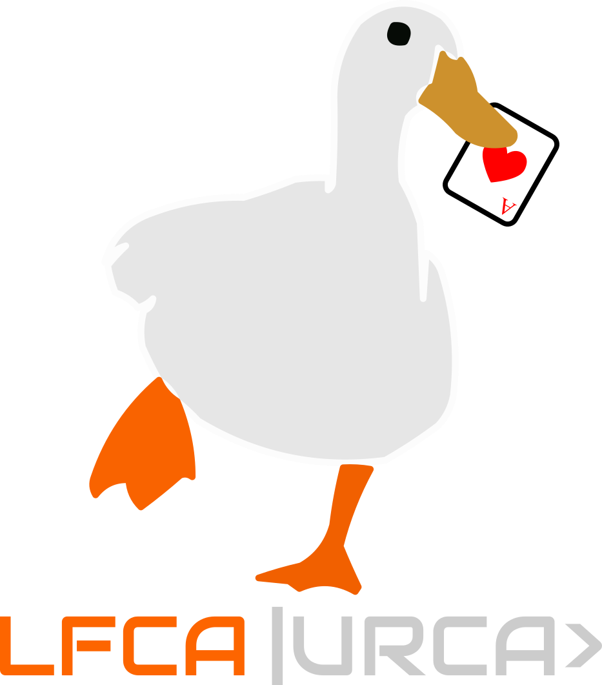

# HADRON

Jogo de tabuleiro estratégico e educacional sobre física de partículas. Os jogadores produzem quarks em aceleradores, constroem hádrons e núcleos atômicos e disputam 12 pontos de estabilidade. Este repositório guarda o protótipo eletrônico, que roda direto no navegador.

**Jogar:** https://apianomorais.github.io/hadron/

## Créditos



Criado por **Apiano F. Morais**, **Job S. Furtado Neto** e **Ivan C. Jardim**.

Desenvolvido pelo **LFCA**, Laboratório de Física Computacional Aplicada da Universidade Regional do Cariri (URCA).

## Como jogar

- De 3 a 4 jogadores no mesmo aparelho. O computador pode ocupar qualquer lugar.
- Na sua vez, role 2d6. Os hexágonos com o número sorteado produzem o seu quark para as construções vizinhas: cada hádron recebe 1 e cada núcleo recebe 2.
- As somas 2, 7 e 12 ativam os Campos Quânticos (Decaimento, Higgs e Fusão) em vez de produzir.
- Depois de rolar, negocie com o banco, com a Energia ou com outros jogadores, construa e jogue até 1 Carta de Interação.
- No fim de cada turno, todo Top vira Charm + 1 Energia e todo Bottom vira Strange + 1 Energia.
- Vence quem chegar a 12 pontos de estabilidade no próprio turno.

As regras completas, as escolhas de design e a estatística da partida ficam no botão **Regras** dentro do jogo.

## Distribuição dos hexágonos

Cada hexágono produz um único tipo de quark. A raridade acompanha a abundância dos quarks na natureza.

| Quark | Números | Hexágonos | Chance por rolagem |
|---|---|---:|---:|
| Up | 6, 8, 9 | 3 | 38,9% |
| Down | 4, 6, 8 | 3 | 36,1% |
| Charm | 3, 5, 9, 10 | 4 | 36,1% |
| Strange | 4, 5, 10, 11 | 4 | 33,3% |
| Top | 11 | 1 | 5,6% |
| Bottom | 3 | 1 | 5,6% |
| Campos Quânticos | 2, 7, 12 | 3 | 22,2% |

As porcentagens somam mais de 100% porque há números compartilhados: um 6 produz Up e Down ao mesmo tempo. Os 19 hexágonos são embaralhados a cada partida, sem 6 e 8 vizinhos.

## Escolhas de design do protótipo

Onde o GDD deixava a regra aberta ou se contradizia, o protótipo decidiu assim:

1. Núcleos evoluem sobre um hádron do próprio jogador e pagam só os núcleons que faltam: Deutério sobre Próton, Nêutron ou Lambda; Hélio-4 sobre Deutério; Lítio-7 e Carbono-12 sobre Hélio-4. Por isso o Carbono-12 custa 2 Energias, já que o Hélio-4 contém os 2 prótons e 2 nêutrons pedidos no GDD.
2. Todo núcleo produz 2 recursos, como as cidades do Catan.
3. Top e Bottom decaem no fim do turno, e não antes da fase de construção.
4. A Energia substitui 1 partícula em qualquer construção, e 3 Energias compram 1 partícula. As Cartas de Reação custam 1 Energia. Antipartícula = partícula + 2 Energias.
5. Lambda pesca 1 carta e pode virar núcleo como um Próton. Lítio-7 converte 1 Up + 1 Down em 1 Top ou 1 Bottom por turno. Píon dá trocas 2:1 com o banco. Káon é imune ao Campo de Higgs.
6. Campo de Fusão: dois oponentes perdem 2 quarks aleatórios cada e ganham 1 ponto cada por um Núcleo Colaborativo.
7. O experimento Bóson de Higgs pede os 4 tipos de núcleo ao mesmo tempo, porque só existem 4.
8. O baralho tem 34 cartas, incluindo 2 Prêmio Nobel e 2 Publicação na Nature, que valem 1 ponto cada.
9. Não há descarte de metade da mão no 7. Os limites de peças (6 hádrons, 5 núcleos, 15 aceleradores) e o mínimo de 5 para a maior cadeia vêm do Catan.

## Resultados das simulações

Em 400 partidas entre jogadores do computador, a vitória levou em média 12,5 rodadas. Os pontos do vencedor vieram 80% de construções, 10% da Maior Cadeia, 6% de cartas de ponto e 4% de Núcleos Colaborativos. Os três experimentos especiais (Bóson de Higgs, Supersimetria e Unificação) praticamente não aconteceram, um sinal de que talvez estejam caros demais.

## Código

| Arquivo | O que é |
|---|---|
| `index.html` | O jogo pronto, gerado pelo `build.py`. Não edite à mão. |
| `src/engine.js` | Motor de regras: lógica pura, estado em JSON. |
| `src/ui.html` | Interface: tabuleiro em SVG, painéis e janelas. |
| `tests/sim.js` | Simula centenas de partidas completas e confere as regras a cada jogada. |
| `assets/` | Símbolo do LFCA/URCA. O `build.py` embute a versão de 256 px no `index.html`. |

```
python3 build.py      # regenera index.html a partir de src/
node tests/sim.js     # roda as simulações
```
